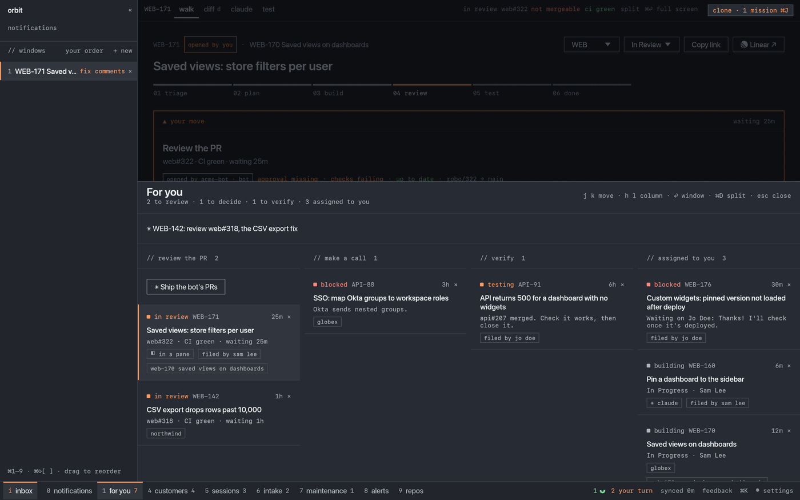
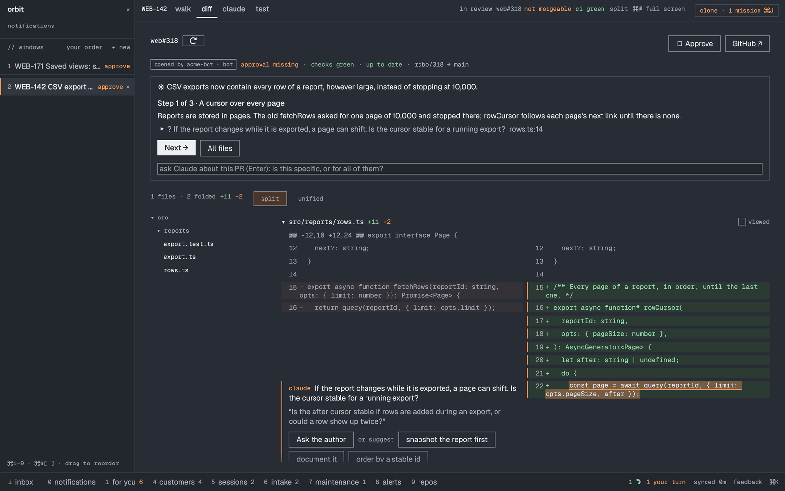

<h1 align="center">Orbit</h1>

<p align="center">
  <b>Your backlog drives your agents. You review and decide.</b><br>
  A native macOS app for product engineers: Linear, Claude Code and code review in one window.
</p>

<p align="center">
  <a href="#install">install</a> ·
  <a href="docs/why.md">why orbit</a> ·
  <a href="docs/clone.md">the clone</a> ·
  <a href="docs/make-it-yours.md">make it yours</a> ·
  <a href="docs/cloud-agents.md">cloud agents</a> ·
  <a href="docs/features.md">features</a>
</p>

<p align="center">
  <a href="https://github.com/ArzelaAscoIi/orbit/actions/workflows/ci.yml"></a>
  <a href="https://github.com/ArzelaAscoIi/orbit/releases/latest"></a>
  <a href="LICENSE"></a>
  
  
</p>

---

<p align="center"></p>

Agent tools give you more terminals. **Orbit gives your agents a backlog.**

Every ticket shows its stage and the one move it needs. Every ticket gets its
own agent session in a clean git worktree. Every PR comes back as a walkthrough
you can question line by line. You make the calls: approve, merge, ship.

Linear stops being the place you click around in. It becomes the API your
agents work from.

## Why not herdr, a plain shell, or Xirp?

They run agents well. None of them knows **what** your agents should work on,
or **why**.

|                                                   | plain shell | [herdr](https://github.com/herdrdev/herdr) | [Xirp](https://backstage.spotify.com/docs/xirp) | **Orbit** |
|---------------------------------------------------|:-----------:|:-----:|:-----:|:---------:|
| Many agents in one window, see who needs you      | –           | ✓     | ✓     | ✓         |
| A clean git worktree per task                     | by hand     | –     | ✓     | ✓         |
| Work starts from the ticket, not from a prompt    | –           | –     | –     | ✓         |
| Triage → plan → build → review → test on the ticket | –         | –     | –     | ✓         |
| Your team's workflow as config and skills         | –           | –     | rules | ✓         |
| PR walkthrough: ask the diff, approve, merge      | –           | –     | –     | ✓         |
| Fork it and own it                                | –           | ✓     | –     | **the point** |

The long version, including what each one does better: **[docs/why.md](docs/why.md)**.

## Three tools in one

**1. The backlog is the interface.** Orbit reads Linear and shows only what
waits on you: a PR to review, a call to make, a merged fix to verify. The
rest is your agents' work. Like [firstmate](https://github.com/kunchenguid/firstmate),
it talks to you in outcomes. Unlike it, the queue is your team's real backlog.

**2. Agents, split and orchestrated.** Triage, Plan, Build and Fix run in each
ticket's own Claude Code (or Codex) session, in the background, in its own
worktree. Panes, tabs, and status from Claude Code's hooks tell you who is
working, who is asking and who is done. **Run the board** works the whole
backlog unattended and reports back. herdr's multiplexing, but every pane
knows its ticket.

**3. Review, without the bot noise.** The diff becomes steps in reading order,
each with what to check. Your questions get answered from the diff and the
ticket, and suggested comments land on the right line. Approve and merge happen
only on your click, bound to the commit you read. Think CodeRabbit, minimal,
with you in charge instead of commenting at you.

<p align="center">
  
  
</p>

## The clone: one goal, many agents

Say what you want in your words. Your clone (a Claude Code chat, Cmd+J) files
it as a parent with sub-tickets in blocker order. Then Orbit drives them: two
at a time, blockers merged first, each to the cloud bot or a local session in
its own worktree. You hear only about a PR to review, a block, a merge. The
clone coordinates and never writes code; approve and merge stay yours.
How it works: **[docs/clone.md](docs/clone.md)**.

<p align="center"></p>

## And if that is not enough: ⌘K beats github.com

Not everything is the clone's job. For the rest, Orbit is simply the fastest
way through GitHub and Linear.

- **Cmd+K, paste a PR link.** It opens here, at once, on its diff. No tabs, no
  spinners, no "Load diff" buttons.
- **Or type what you remember**: a word from the title, the ticket, the repo.
  Enter. You are on it.
- **Then ask.** Every PR gets its own Claude Code session with the PR, its
  ticket and the code as context: *why this change, what could break, is this
  the thing the ticket asked for?*

Fewer clicks, less waiting, and the context comes with you.

## Make it yours

Orbit is not meant to be used as is. **It is meant to be forked.**

Agents write whatever code you ask for. So the tool that runs your agents
should work the way your team works, not the way a vendor guessed. Everything
company-specific in Orbit is configuration: a profile with your bot, its
commands, your routing and your skills. The rest is plain Rust that Claude Code
reads and changes in minutes.

- **On Jira?** Not supported, but one prompt away: the Linear client is one file.
- **Something annoys you?** Press Cmd+Shift+F. A Claude session changes Orbit in a
  worktree, runs the checks and opens a PR on your fork.
- **Your team's way of working?** Put it in `profiles/<team>/`: one JSON file and a few `SKILL.md`s. A full example: [`tests/profiles/acme`](tests/profiles/acme).

It takes little maintenance, and it's fun. **[docs/make-it-yours.md](docs/make-it-yours.md)**

## Cloud agents

Orbit is local first: every agent runs on your Mac. If your team also runs a
bot in the cloud that plans and builds from Linear comments, Orbit follows it.
You see its plan on the ticket and its PR on the rail, and a ▼ hands it the next
step. **[docs/cloud-agents.md](docs/cloud-agents.md)**

## Roadmap?

There is none. Orbit works very well today, and anything you are missing is a
prompt away in your fork. Why plan features for months when you can have them
now?

What we do have is a direction: agents that need less of you, in three steps.

1. **Make coding agents do what you want.** Done. Every ticket gets its own
   agent, briefed with the ticket and your team's skills, in its own worktree.
2. **Make them autonomous, and orchestrate many of them.** Here today. The
   clone drives a goal of many tickets, and Run the board works your backlog
   unattended. You still approve and merge.
3. **Make them know what you want.** Not there yet. This is the open problem,
   and the interesting one.

## Install

```sh
gh release download --repo ArzelaAscoIi/orbit --pattern '*-macos.zip'
unzip -q *-macos.zip && mv Orbit.app /Applications
xattr -dr com.apple.quarantine /Applications/Orbit.app   # not notarized yet
```

Open it, click **Sign in with Linear** and pick your teams. Then press Cmd+K and choose
**Start the tutorial** for a two-minute tour of every feature.

Needs [Claude Code](https://claude.com/claude-code) or [Codex](https://developers.openai.com/codex),
`gh auth login`, and Apple silicon. An Anthropic key (Settings) turns on
walkthroughs, briefs and test plans.

From source:

```sh
make run      # release build; sign in with Linear (or LINEAR_API_KEY in .env)
make watch    # rebuilt and restarted on every save
make check    # fmt + clippy + tests
```

## Docs

- [Why Orbit](docs/why.md): the problem, and an honest comparison
- [Make it yours](docs/make-it-yours.md): fork it, write a profile and skills, add Jira
- [The clone](docs/clone.md): one goal, many agents, driven in blocker order
- [Cloud agents](docs/cloud-agents.md): a team bot that works from Linear comments
- [Features](docs/features.md): every view, key and button
- [Decisions](docs/decisions.md): every product decision, each one guarded by a test
- [Contributing](CONTRIBUTING.md) · [Security](SECURITY.md)

## License

MIT. Built with Claude Code, for people who build with Claude Code.
