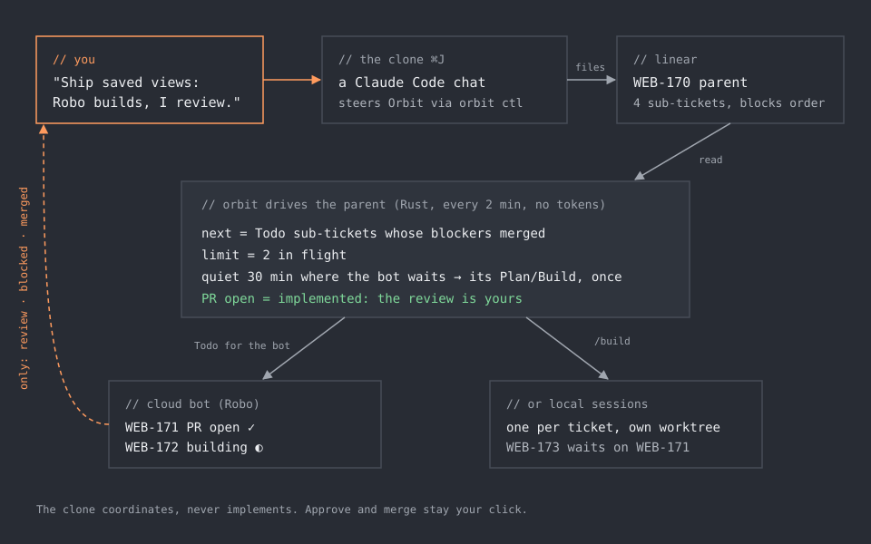
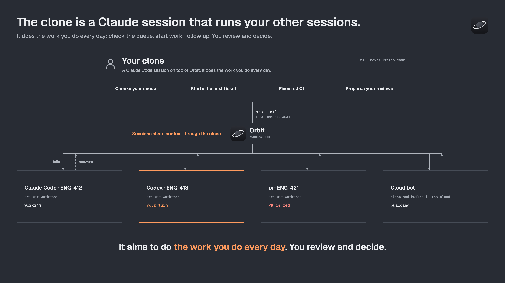
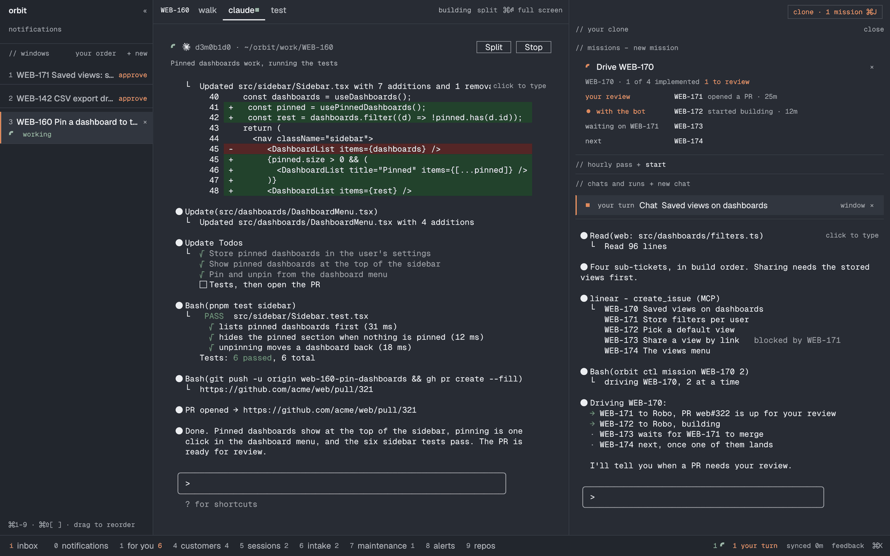

# The clone

One agent per ticket is easy. A feature of five tickets that land in the
right order, while you do something else, is the hard part. In Orbit that is
the clone's job.

<p align="center"></p>

## What it is

The clone is your agent double: a Claude Code chat on the right of the window
(**Cmd+J**), running on your own login. It does not write code. It works
**Orbit** for you, through `orbit ctl`, the same buttons you click:

```sh
orbit ctl state                  # where Orbit is, what waits on you
orbit ctl tickets                # For you, in its order
orbit ctl sessions               # every session: working, asking, its PR, why it failed
orbit ctl do '{"Show":"Sessions"}'   # press any button Orbit has
```

Every action it takes shows in your window as it happens (a grey "agent"
toast) and is logged as the clone's, never as yours. The buttons that belong
to you stay yours: `orbit ctl` refuses to approve or merge, and Orbit never
posts a bot command the clone wrote.

## How the clone works Orbit

<p align="center"></p>

You run many agents at once: some on your Mac, some in the cloud. Each one
works alone and none of them knows about the others. Someone has to know
which session waits on you, which PR went red, which ticket is next. In Orbit
that is the clone. It handles this through `orbit ctl`, the command line of
the running app, so you stay on top of the work without checking every
session yourself.

`orbit ctl` talks to the Orbit window you have open, through a local socket.
Every command prints JSON. There is no second copy of the board and no API of
its own: the clone sees what you see and presses the buttons you could press.

**It reads every session.** One call lists them all, local and remote:

```sh
orbit ctl sessions          # every session: ticket, agent (Claude Code, Codex, pi),
                            # state (working, your turn, needs approval, done, failed),
                            # its last note, the question it waits on, its PR,
                            # the ticket's Linear state, why it failed
orbit ctl ticket WEB-160    # one ticket: card, PRs with their merge gates, session
orbit ctl alerts            # alerts, live incidents, red releases, and who is on them
orbit ctl tickets           # For you, in its order
```

The states come from the hooks Orbit puts in every session it starts, so
"your turn" means Claude asked or finished, not a guess from the screen.

**It dispatches work, locally or remotely.**

- *Locally*: a Claude Code session on the ticket, in its own git worktree,
  started with a skill: `/plan`, `/build`, `/fix-pr-comments`, an alert
  investigation, a red release.
  ```sh
  orbit ctl do '{"RunSkill":{"issue_id":"<id>","command":"/fix-pr-comments","submit":true}}'
  orbit ctl wait WEB-160 "your turn" done failed --timeout 600
  ```
- *Remotely*: the team's cloud bot. A mission moves each sub-ticket to the
  bot's Todo, which is the bot's go, and Orbit waits on it without a session
  polling: `orbit ctl mission WEB-170 2`. `orbit ctl follow WEB-170` builds
  the same parent in local sessions instead.

**It manages what runs.** It closes sessions whose PR merged
(`orbit ctl close`), restarts a fix when checks go red, prepares your reviews
in one session, and stops starting new work while five or more things wait
on you. Linear changes (a comment, a move, a parent, a blocks relation) go
through Orbit's own key: `orbit ctl comment`, `move`, `parent`, `block`.

**It tells you, briefly.** After each step it says one line in the window
(`orbit ctl say`): a grey agent toast, and a Mac notification when Orbit is
behind other windows. In a loop it says nothing when nothing changed.

**You keep the last word.** Every action has a gate (`orbit ctl actions`):

| Gate    | What it covers                                   | The clone           |
|---------|--------------------------------------------------|---------------------|
| look    | views, tickets, reading                          | presses             |
| do      | starting, stopping, closing local sessions       | presses             |
| queue   | what others see: Linear states, comments, PR reviewers | only when you asked |
| yours   | approve, merge, a permission prompt              | refused             |

Every press shows in your window as it happens and is logged as the clone's,
never as yours (`orbit ctl log`). It never writes a bot command itself: only
your click posts one.

## How a goal becomes merged PRs

**1. You say what you want, in your words.**

> Ship saved views for dashboards: per-user saved filters, shareable links,
> a default view. Robo builds, I review.

**2. The clone files it.** A mission run reads the code and the backlog, then
files one parent ticket with short sub-tickets in the right team, linked with
*blocks* relations for their order. If an item adds a setting or touches
another product surface, it asks you once before filing.

```
WEB-170  Saved views on dashboards
├─ WEB-171  Store filters per user
├─ WEB-172  Pick a default view
├─ WEB-173  Share a view by link       blocked by WEB-171
└─ WEB-174  The views menu
```

**3. Orbit drives the parent.** This part is plain Rust, not an agent: every
two minutes it reads the parent again and moves it forward.

- **Next** are the sub-tickets whose blockers have merged.
- **At most two** are in flight at once.
- Each goes to a worker: the team's cloud bot (moved to its Todo) or a local
  session on that ticket, in its own worktree, started with `/build`.
- A sub-ticket the bot sits on for 30 minutes (plan done, no build, a red PR)
  gets the bot's exact Plan or Build command once, and you hear that it did.
- A sub-ticket with its PR open counts as implemented. The review is yours.

Waiting costs nothing: no session sits there polling, and no tokens are spent
while the bot works.

**4. You hear only what is yours.** A PR to review, a sub-ticket the bot
blocked, a merge. Each is one notification and one line in the initiative's
log (`orbit ctl initiatives`), with times and why each sub-ticket is where it
is: *with the bot*, *waiting on WEB-171*, *next*.

<p align="center"></p>

A finished mission stays in the panel under *finished* for two days, saying
how it ended ("the reviews are yours: 2 PRs", or "stopped by you"), then
folds into *earlier*.

**5. You review and merge.** The next sub-ticket starts as soon as its blocker
merges. When every sub-ticket has its PR, the initiative is done.

## The hourly pass

Beside initiatives, the clone can run your board every hour while you work
on something else. Tick what it may take care of (alerts, notifications, For
you, PRs, sessions, initiatives) and press **Start**: one Claude Code session
runs `/loop 1h /operate` on exactly those. It stays quiet when nothing changed,
says once when something did, and shows `last run failed` until a later run
gets through. Untick everything to pause it.

## Rules it keeps

- **It coordinates and never implements.** "Build X" means handing X to a
  worker, never a commit in its own shell.
- **Check-ins go on the ticket** as Linear comments, written through Orbit's
  own key, so your team sees them where they look.
- **Your pause wins.** Stop or wait undoes pending merges (out of the merge
  queue, auto-merge off) and stays until you clear it.
- **It learns from your complaints.** When you correct it, it writes the
  learning to a file first, so the next run already knows.

## Make it drive your way

`settings.json` → `clone`:

```json
"clone": {
  "instructions": "Prefer the bot for API work, local sessions for UI.",
  "skills": ["operate", "mission"],
  "tasks": ["alerts", "notifications", "prs"]
}
```

The skills it runs (`skills/operate`, `skills/mission`) are plain Markdown in
this repo. Change them like any other code; see
[make it yours](make-it-yours.md).
