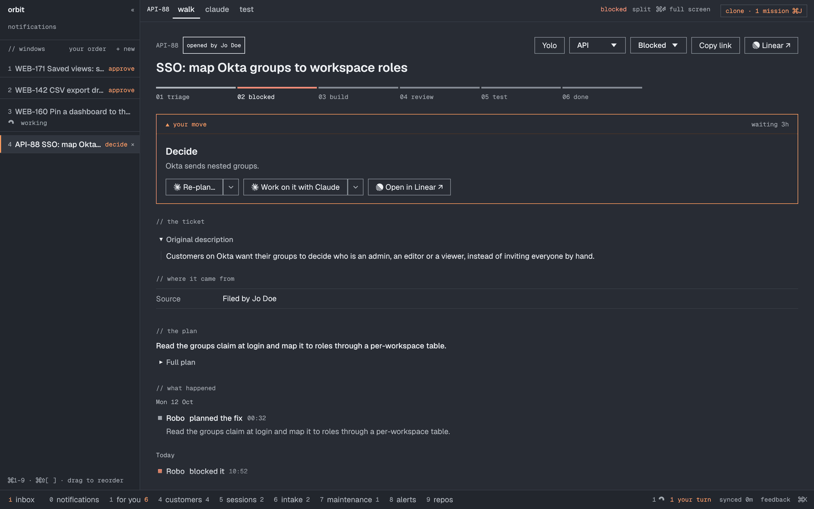
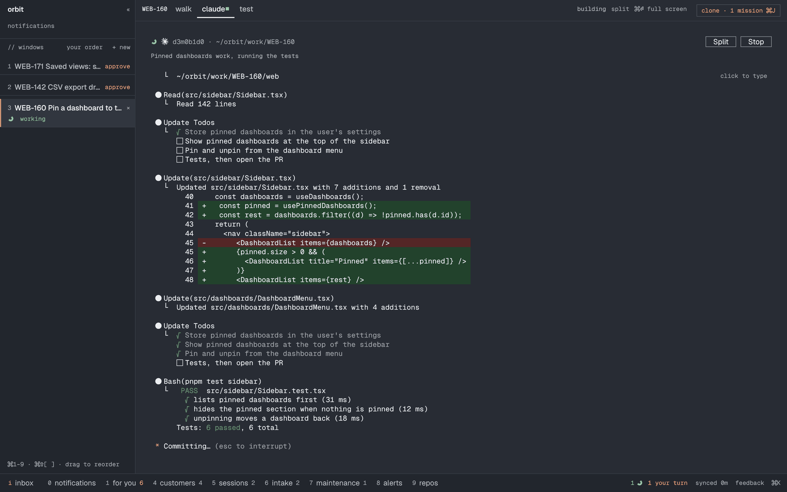
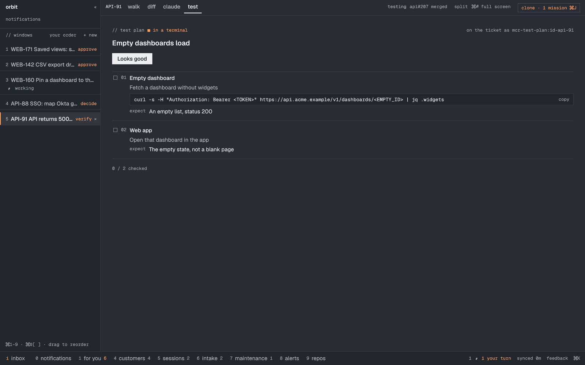

# Features

Every view, key and button. The two-minute version is in the app: Cmd+K → **Start the tutorial**.


### Plan my day: the day ranked by your goals, and the work done for you

Key **2**. One Claude Code run reads this week's goals and each team's priority doc
first, then your Linear, Slack, alerts, incidents, GitHub and Notion (read-only), and
writes the day: the focus, what to do first (your own tickets next to work a session
can do alone), who to reach out to, blind spots, and what can wait.

The best things a session can do start by themselves, in priority order, two at a
time: a red PR fixed, a noisy alert tuned, a quick action in a ticket's own session.
Filing a new ticket stays your click. Without goals for the week, it first finds them
in your prio docs, your own channel posts, the initiatives you own and meeting notes.

```json
"work": {
  "instructions": "I lead the platform team. Top priority: the new billing service.",
  "autoStart": 2,
  "modes": [{ "name": "KTLO sweep", "instructions": "Only CVEs, repeating alerts, red CI." }]
}
```


### For you: only what waits on you


Key **1**. Review a PR, make a call, verify a merged fix, and what is assigned to you,
in columns. A one-line brief on top says the single most pressing thing.


### Notifications, and a ping on your Mac when you are needed

Key **0**. Linear and GitHub notifications in one list, only what asks something of
you, one row per ticket or PR. When a ticket starts asking for you, a review is
requested or you are assigned, your Mac shows one short line, only while Orbit is not in
front; it keeps checking behind other windows. Activity on your own PRs never pings.


### A ticket: your move, with every bot step at hand



Each ticket shows where it is on the rail (triage, plan, build, review, test, done) and
the one move it needs, with the buttons to make it:

- **Triage, Plan, Build, Fix** run the step in the ticket's own Claude session, in the
  background, or (the ▼ arrow) hand it to the team's bot remotely.
- **Fix CI** when only the checks are red: it fixes their root cause and nothing else.
- **Fix N comments** runs fix-pr-comments on the PR's unresolved threads: fixes, pushes,
  replies and resolves. Nothing merges on its own.
- The description with images and formatting, who opened it, where it came from, and a
  reply box that posts to Linear.

### Review PRs like a reviewer sits next to you


The Diff tab shows the ticket's PR. **Walk me through** turns the diff into steps in
reading order, each with what to check and one-line questions worth asking; open one
for the comment to the author and suggested fixes, drafted onto the right line.

Ask Claude anything in your own words (is this specific, or should it cover all of
them?): it answers in a few sentences from the diff, the ticket and the step you are on,
and remembers what you asked. Once you asked, **Note for the approval** writes one short
line in your voice ("Makes sense, I also checked..."), and **Approve** posts it.

**Review ▾** beside Approve posts a Comment or Request changes review with your summary and
any drafted line comments, at the commit you saw.

Approve, merge, add to the merge queue, merge when ready, update the branch: each only
on your click, bound to the commit you saw, checked again right before. **Review the
changes** after new commits shows what changed since your review.


### Claude Code per ticket, in a real terminal



Every ticket, PR and free session gets its own Claude Code session, running in the
background (`claude --bg`), attached in the Claude tab and resumable after a restart.
It is your own Claude Code: your skills, plugins, MCP servers and settings come along;
the app adds its skills (triage, plan, build, fix-pr-comments, spot, orchestrate) and
the profile's fine-tuning. With Codex picked in Settings, new sessions run in Codex's local
daemon instead, in a native pane with Allow / Decline on each permission it asks for.
With [pi](https://pi.dev) picked (offered once `pi` is on your PATH), a ticket gets an
interactive `pi` in its own terminal and folder, resumed by its session id. Orbit's pi
extension shows working, your turn and needs approval like Claude's, blocks what the
session's rules refuse and asks in pi before anything else that is not allowed. Unattended
runs (the board, the clone, Plan my day) stay on Claude Code.
Cmd+click a link Claude prints: a Linear ticket or a PR opens
right here, a PR on its Diff tab. Select to copy.

### Windows, panes and shells

A strip of windows on top (Cmd+1 to 9), and inside each, panes side by side: Cmd+D to the
right, Cmd+Shift+D below, each a full ticket with its own tabs. Cmd+N opens a new tab:
For you, your login shell (k9s, logs, anything) or a new ticket.


### Testing: close merged work in two minutes



A ticket in Testing gets a short test plan: steps to tick, commands to copy for backend
changes, and for UI changes the page to check in a browser beside the steps. Claude
writes it once and posts it on the ticket. **Looks good** moves it to done.


### Run the board, and the autopilot

**Run the board** (Sessions) starts one unattended Claude run that operates your board:
lands approved PRs, fixes red ones, splits Blocked tickets, refills Todo, grooms Triage,
hands KTLO to the bot, then reports what is ready for you. It never approves. Switch on
the **autopilot** in the morning and it runs every hour, never while a run is still
working, and turns itself off after eight runs.


### Sessions: every Claude session on your Mac

Grouped by what they need: approval, working, your turn. Start a session for work with
no ticket, in its own folder or one you name. Orbit stops its own background sessions that
sit idle out of sight for 12 hours (an hour once their ticket is done), so finished work
holds no memory; opening one resumes it where it left off. `keepIdleSessions` keeps them
running, `idleSessionHours` changes the wait, `orbit sessions-stop --dry-run` lists them.


### Stories, customers, intake

- **Stories** (3): open work grouped by the story it belongs to, so a sweep of twenty
  tickets reads as one piece of work.
- **Customers** (4): which customers have tickets and what needs you for each, with a
  one-line summary per customer.
- **Intake** (6): triage with Claude. It clusters new tickets, folds duplicates and
  proposes what to accept, park or cancel; nothing is written until you approve.


### KTLO and security, isolated from product work

Key **7**. Scanner CVE tickets, anything labelled Security, and the alerts the bot's
sweeps file live here, never in product views. Run the board gives them to the bot on
every team's board and drives each to a PR, at most two at a time. With an incident.io
key, live incidents sit on top; **Investigate** opens a briefed Claude session with k9s
beside it.


### New ticket: type what is wrong, paste links, done

Cmd+T. Write it in your own words. Haiku sorts it into bug, feature or UX, picks the
team, area and priority, checks every team's open tickets for a duplicate with the same
evidence, asks up to three short questions when it is not obvious, and files it triaged
in the right Backlog. **Laya** (built in, offline, on by default; the app downloads it
once, 840 MB) takes over the bug-or-not decision when it is sure: 96% right on 166
labelled tickets. It also proposes quick actions on a ticket and lifts sessions that ask
you something. `"laya": { "mode": "off" }` in settings.json turns it off.

### Command palette

Cmd+K from anywhere: tickets (your board and all of Linear), sessions, stories,
customers and every action, the selected ticket's first. Whatever you typed can become a
new ticket or a new session. **Debug prod** opens k9s and Claude side by side after the environment's
login command (settings.json `debug`).


### Feedback: the app improves itself

Cmd+Shift+F when something should be better. A Claude session on Orbit's own repo reads
what you just did from the local activity log, asks what to change, makes it in a
worktree, runs the checks and opens a PR.


### Profiles, settings, themes

- **Profiles** hold everything company- or person-specific: the team's bot and its
  commands, which skill each step runs, routing, KTLO rules, the orchestrator's board.
  **Set up with Claude** in Settings writes yours; without one, the app is a generic
  Linear client with Claude Code per ticket.
- **settings.json**, shown and edited in Settings (Cmd+S applies it). Keys typed there
  move to the Keychain on save.
- **Four themes**: Phosphor, Amber CRT, Graphite, Lab Paper, or follow the system
  (Cmd+Shift+T).


### Profiles: where company specifics live

Orbit itself is generic. Everything about one company or one person's way of
working is configuration in a profile, never code:

```
profiles/<name>/profile.json            bot + commands, GitHub org, routing, KTLO rules, prompts' extras, settings defaults
profiles/<name>/skills/<skill>/EXTRA.md fine-tuning appended to the app's own skill (e.g. the company's repo map)
profiles/<name>/skills/<own>/SKILL.md   a skill of the company's own
profiles/<name>/k9s/                    views and plugins for the debug panes
profiles/default                        one line: the profile a fresh settings.json starts with
```

Every folder under `profiles/` is compiled in (build.rs). Without any, the app is a
plain Linear client with Claude Code per ticket. A profile can also be imported in
Settings as one `.json` bundle or an `https://` URL, or written with **Set up with
Claude**. All fields and their defaults: `src/profile.rs`.

A company fork carries its profile (and an `overlay.mk` with its bundle id and
release repo, see the Makefile) as one commit on top of this repo, so generic
changes land here and merge into the fork cleanly.

### Also

- **Live:** follows Linear and every session as they change, and keeps checking while
  the window is hidden.
- **Optimistic:** your change shows at once and never flickers back.
- **Several copies:** run more than one window; they share sessions and sign-in safely.
- **Cleans up after itself:** session folders and dependency caches pile up (tens of
  GB). Once a day Orbit quietly removes what can be rebuilt (ignored `node_modules`,
  `.venv`, `target`, ... in folders idle for a week) and whole folders whose ticket is
  done or that sat untouched for a month, only when every checkout in them is clean
  and pushed. Settings → about shows one line with the result; `orbit cleanup
  --dry-run` lists what would go; `"noCleanup": true` in settings.json turns it off.
