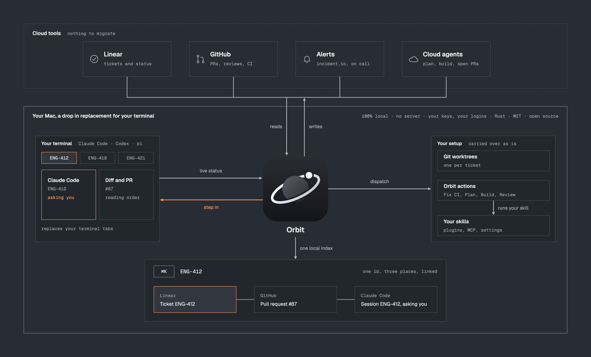
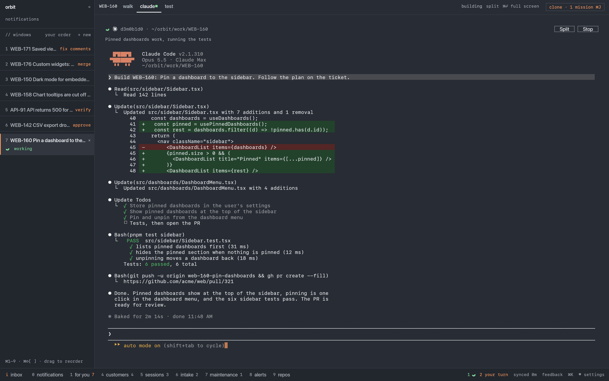
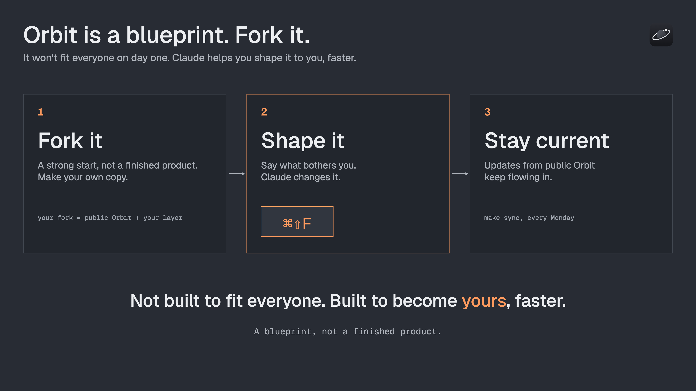

# LinkedIn series: introducing Orbit

Five posts that introduce Orbit one idea at a time. Each one stands alone,
links the repo, and sets up the next. The drafts are starting points: the
shape and the hook are decided, the wording is not.

Repo link for every post: https://github.com/ArzelaAscoIi/orbit

## The arc

| # | Post | The one idea | Visual |
|---|------|--------------|--------|
| 1 | Your brain is the scheduler | Running agents is solved. Knowing what they should do, and who needs you, is not. | `chaos-vs-control@2x.png` |
| 2 | Introducing Orbit | The backlog drives your agents. You review and decide. | `orbit-arch.png`, then `demo.gif` |
| 3 | One window for every session | A drop-in for your terminal: every ticket, its session and its PR in one place. | `one-window.png` |
| 4 | The clone | A Claude session that runs your other sessions. | `orbit-clone-overlay.gif`, `clone-works@2x.png` |
| 5 | Fork it | Not built to fit everyone. Built to become yours. | `fork-it@2x.png` |

Cadence: two a week (Tuesday and Thursday mornings), so the series runs
under three weeks and each post can point back to the last one.

## Review of the original order

The first plan was: 1. Orbit and its architecture, 2. the drop-in for all
the Claude sessions, 3. the clone, 4. make it yours. What changed and why:

- **Open with the pain, not the architecture.** An architecture diagram as
  the first thing people see asks them to care before they know why. The
  before-and-after image is the hook almost everyone running agents has
  felt: four terminals, and no idea which one needs you. The architecture
  comes second, as the answer.
- **One idea per post.** "Orbit + architecture" was two ideas. Post 2 now
  says what Orbit is in one sentence and uses the diagram and the demo GIF
  as proof, not as the topic.
- **Show, then name.** Post 3 leads with the screenshot of one window and
  only then calls it a drop-in for the terminal. People recognise the
  sidebar, the session and the PR before they read a feature list.
- **The clone needs a contrast.** Post 4 builds on post 3: "you now see
  every session; the clone watches them for you". Without post 3 the clone
  reads like another agent framework.
- **End with an invitation.** "Make it yours" is the call to action of the
  whole series, so it goes last and asks for something concrete: fork it,
  press Cmd+Shift+F, tell me what you changed.
- **Same frame on every post:** a one-line hook, the problem in two or three
  lines, what Orbit does about it, one visual, the repo link, a question.
  Readers learn the format and skim faster.

## Post 1: Your brain is the scheduler

Visual: `../assets/chaos-vs-control@2x.png` (BEFORE side cropped first, or
the whole image).

> Draft
>
> I run five Claude Code sessions at once. That part is easy now.
>
> The hard part: which one is waiting for me? What was this one about?
> Is this PR the thing the ticket asked for?
>
> Four terminals, and my brain is the scheduler. Every switch costs focus,
> and the context lives in my head.
>
> So I built the tool I wanted instead: one window where the backlog is the
> scheduler. More on Thursday.
>
> How many agent sessions do you run at once, and how do you keep track?

TBD: whether to name the tool in post 1 or keep it a teaser.

## Post 2: Introducing Orbit

Visual: `../assets/orbit-arch.png` first, `demo.gif` as the second slide or a
comment.

> Draft
>
> Agent tools give you more terminals. Orbit gives your agents a backlog.
>
> Orbit is a native Mac app (Rust, open source) that sits between the tools
> your team already uses (Linear, GitHub, alerts, cloud agents) and the
> agents on your machine (Claude Code, Codex, pi).
>
> - Every ticket gets its own agent session in its own git worktree.
> - Every ticket shows the one move it needs: review, fix, merge, verify.
> - Every PR comes back as a walkthrough you can question line by line.
>
> No server, nothing to migrate, your own keys. You make the calls:
> approve, merge, ship.
>
> https://github.com/ArzelaAscoIi/orbit

TBD: one line on who it is for (product engineers who run several agents).

## Post 3: One window for every session

Visual: `../assets/one-window.png`.

> Draft
>
> This is what replaced my terminal tabs.
>
> Left: every ticket I am on, with the one move it needs (fix comments,
> merge, verify, approve) and which agent is working.
> Middle: that ticket's Claude Code session, the real one, with everything
> it did.
>
> Orbit starts each session with hooks, so "your turn" means Claude asked
> or finished, not a guess. One click and I am in the session that needs me,
> with the ticket and the PR next to it.
>
> It is a drop-in for the terminal: your Claude Code, your skills, your
> settings, unchanged.
>
> What would you need to see in that sidebar?

TBD: a short screen recording instead of the still.

## Post 4: The clone

Visual: `../assets/orbit-clone-overlay.gif`, then `../assets/clone-works@2x.png`.

> Draft
>
> Seeing every session in one window helped. Watching them all still took
> my day.
>
> So Orbit has a clone: a Claude session that runs my other sessions. It
> drives Orbit through its CLI (`orbit ctl`), the same buttons I would
> press:
>
> - checks the queue and closes what is finished,
> - starts the next ticket, locally or on the cloud bot,
> - restarts a fix when CI goes red,
> - prepares my reviews.
>
> Give it a goal and it files the tickets in the right order, then drives
> them two at a time. I hear about a PR to review, a block, a merge.
>
> It never writes code, and approve and merge stay my click.
>
> What part of your day would you hand to it first?

TBD: a 20 second clip of the clone filing a mission.

## Post 5: Fork it

Visual: `../assets/fork-it@2x.png`.

> Draft
>
> Orbit will not fit your team on day one. That is on purpose.
>
> Tools used to grow a setting for every team that asked. With agents,
> changing the code is cheaper than configuring it. So Orbit is a
> blueprint:
>
> 1. Fork it. Your team's setup lives in one folder of its own.
> 2. Shape it. Press Cmd+Shift+F, say what bothers you, Claude changes Orbit
>    and opens a PR on your fork.
> 3. Stay current. `make sync` brings in public Orbit every Monday.
>
> Not built to fit everyone. Built to become yours, faster.
>
> Fork it and tell me the first thing you changed:
> https://github.com/ArzelaAscoIi/orbit

TBD: a real example of a change made with Cmd+Shift+F, with its PR.

## Before posting

- Check every visual for real names, tickets or paths.
- Post the repo link in the post itself, not only in a comment.
- Pin the series' first post to the profile while it runs.
