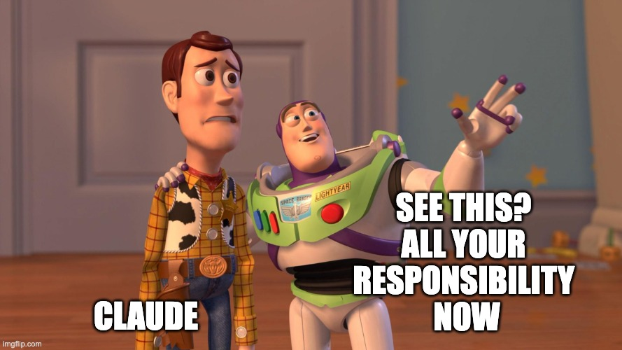

# I finally let agents drive

For a year my agents were fast drivers who didn't know where I live. Every
session I gave directions again: what I promised in a call, why we picked
option B, which session was already on the bug. I was driving from the
passenger seat.

Now I sit next to them and navigate. I pick the destination and have an
opinion about the playlist. The agents do the heavy lifting, and they know me
by heart: they act on what I say, remind me of what I forgot, and keep me from
losing focus. So I get to think about the hard stuff again: strategy, next
steps, the tough technical problems.

What changed is memory. Three tools hold it, each one reachable over MCP or a
CLI.

## Short-term memory: merkwerk

[merkwerk](https://github.com/ArzelaAscoIi/merkwerk) records my calls and my
day on my Mac. Local transcription, local notes, a work log every night from
the window I'm in. Nothing leaves the machine. An MCP server lets Claude dig
through all of it: "what did I promise support by EOD?"

**Why not Granola?** Granola is a great notetaker. It is built for me to read
notes. merkwerk is built for my agents to read context. The difference that
matters: **the agent can annotate a meeting.** A transcript says what was
said, not what was meant. When I clarify later ("that 'next week' meant after
the release", "Jon is Jonne", "that plan was dropped, ignore it"), the agent
saves it with `add_context`, globally or on that one meeting. Every later
summary and every new session reads the transcript *with* my correction. The
meeting gets more correct over time, not more stale.

## Long-term memory: a knowledge graph

Meetings fade, projects don't. A daily sync sweeps Slack, the tracker,
meetings and docs and updates one page per entity: a project, a customer, an
incident, a person. Pages link to each other. "Catch me up on X" walks the
graph instead of searching ten tools.

merkwerk is what happened today. The graph is what is true this quarter.

## Orbit: context across sessions

[Orbit](https://github.com/ArzelaAscoIi/orbit) runs my agent sessions, one
per ticket, and knows about all of them:

- **Peers.** Each session sees what the others are on and what they claim,
  so two agents never fix the same PR.
- **CLI.** `orbit ctl` lets one session (the clone) drive the rest. Give it a
  goal and it files the tickets and drives them, blockers first.
- **Work log.** Every action, local, one JSON line each.
- **Decisions.** Every product decision is one append-only line, guarded by
  a test. The next agent reads why, not just what.

Approve and merge stay my click. The agents drive; I keep the handbrake.

## The navigator's seat

Every morning a steering session pulls all three into one picture: today's
meetings, the graph's open threads, every session and ticket. It proposes the
next move, one decision at a time. I say yes, no or later. What I clarify goes
back into memory, so tomorrow every agent already knows what I meant today.

That's the whole trick. I stopped being the glue and became the navigator.

merkwerk and Orbit run on my Mac. Fork any of it; your feature is one prompt
away.
