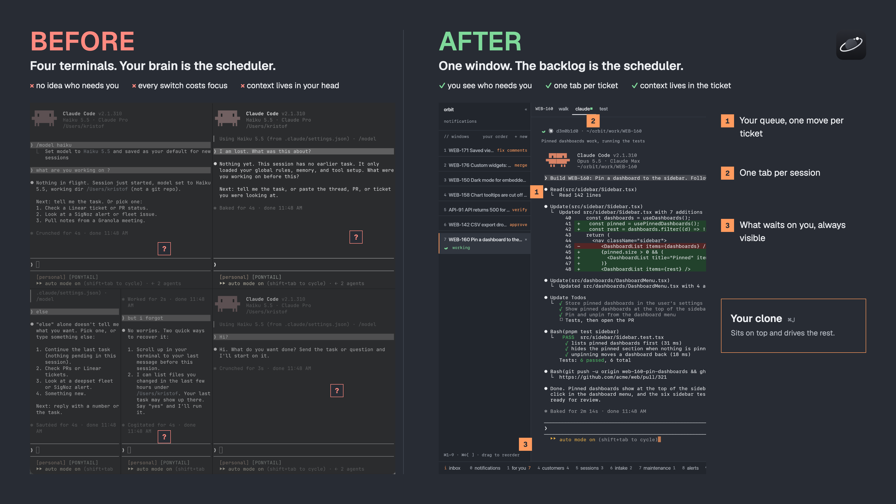
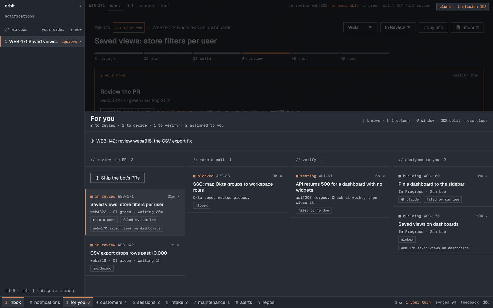

# Why Orbit

## The problem is not running agents

Running five Claude Code sessions is easy now. herdr, tmux, Xirp, a few iTerm
tabs: pick one. The hard part comes after:

- Which five things should they be working on?
- Which one is waiting for me, and for what?
- Is this PR the thing the ticket asked for?
- Did the merged fix actually work?

None of those questions live in a terminal. They live in the backlog, in
the PR, and in your head. A product engineer spends the day moving context
between the three. Agents made writing code cheap, so moving context is now
most of the job.

Orbit puts the three in one window and makes the backlog the source of truth
for what agents do.

## What Orbit is

**A Linear client that runs agents.** Not a terminal that happens to show
tickets. Every view starts from work items:

- **For you** (key 1): only what waits on you. Review this PR. Make this call.
  Verify this merged fix. Ranked, with a one-line brief on top.
- **A ticket**: where it is on the rail (triage → plan → build → review →
  test → done), the one move it needs, and the button to make it.
- **Its session**: Claude Code or Codex, in the ticket's own worktree, briefed
  with the ticket, its comments and your team's skills.
- **Its PR**: a walkthrough in reading order, questions answered from the diff
  and the ticket, approve and merge bound to the commit you read.

You stop using Linear as your interface. You talk to Orbit; Orbit talks to Linear.

## How it compares

Fair comparisons. Each of these is good at what it does.

### A plain shell (or tmux, iTerm tabs)

Fast, free, total control. You keep the context: which tab is which ticket,
which branch, which session asked a question twenty minutes ago. Fine for one
agent. At four it is a juggling act, and you drop things silently.

**Orbit adds:** the mapping from tab to ticket, worktrees made for you, and
status from Claude Code's own hooks, so "your turn" really means the agent
asked or finished.

### [herdr](https://github.com/herdrdev/herdr)

An excellent agent multiplexer: panes, workspaces, live agent state, a server
that survives disconnects, an API agents use to drive each other. If you live
in the terminal and pick your own tasks, it is great. Orbit even reads herdr's
agents and keys if you run both.

**What it does not do:** it has no idea what the work is. No backlog, no
ticket stage, no PR, no review. You are the scheduler.

**Orbit adds:** the backlog as scheduler. Every pane belongs to a ticket or a
PR, and the app knows the next step for each.

### [Xirp](https://backstage.spotify.com/docs/xirp) (Spotify)

An agentic dev environment: persistent sessions, a worktree per task, model
choice, and context from Spotify Portal. Strong if your company runs Portal.

**What it does not do:** your product workflow. It is Spotify's idea of how
work flows, connected to Spotify's catalog, behind a Spotify account. Not
yours to change.

**Orbit adds:** your tracker as the source of tasks, your workflow as config,
and the source code to change everything else.

### [firstmate](https://github.com/kunchenguid/firstmate)

One agent supervises worker agents in disposable worktrees and talks to you
only in outcomes ("PR ready, checks green, merge?"). Orbit took that idea:
scripts own the mechanics, agents do the judgment, you keep merge and every
other call that matters.

**Orbit adds:** the backlog is the queue (durable, shared, the team's truth),
not a markdown file, and the "first mate" is a native UI, not another chat.

### [CodeRabbit](https://coderabbit.ai) and AI review bots

They post a wall of comments on every PR. Some are useful.

**Orbit's take:** the review happens with you, not at you. A walkthrough in
reading order, what to check in each step, your questions answered in a few
sentences, a suggested comment on the right line when you want one. Nothing
lands on the PR until you send it.

### github.com itself

Slow pages, a diff that loads in pieces, and five clicks from "that PR Sam
mentioned" to the line that matters.

**Orbit's take:** Cmd+K, paste the link or type a word from the title, and you
are on the diff. One more key and you are asking Claude about it, with the
ticket and the code as context. Navigation is a feature: every click saved,
every day, adds up to more than any agent trick.

## Orbit in one line each

- **herdr** runs your agents.
- **firstmate** supervises your agents.
- **CodeRabbit** reviews your agents.
- **Linear** tracks your work.
- **Orbit** connects all four, in the way your team works, and you own the code.

## What Orbit is not

- **Not a hosted product.** It runs on your Mac with your Claude Code, your
  keys, your `gh` login. Nothing goes to a server of ours. There is none.
- **Not finished.** It is a strong starting point that one engineer uses every
  day. [Make it yours](make-it-yours.md).
- **Not autonomous by default.** Approving, merging and anything others see
  are your clicks. Autonomy (Run the board, autopilot) is something you switch
  on, and it never approves.
